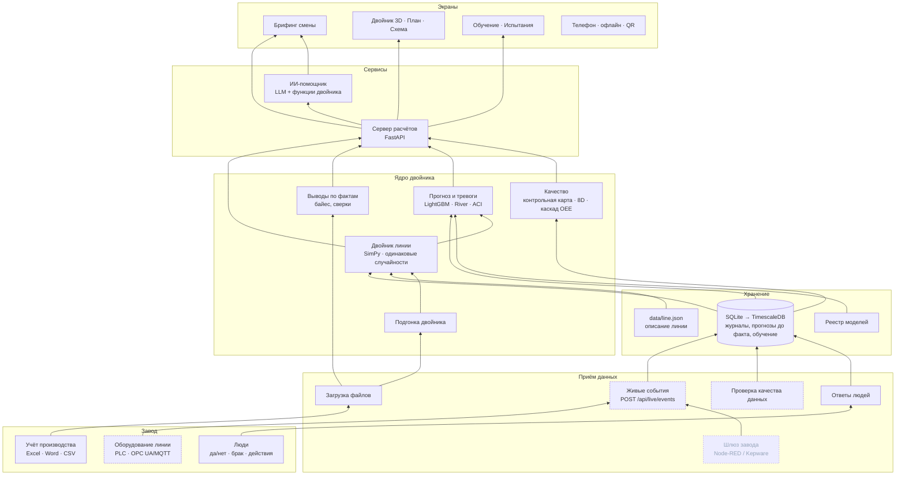
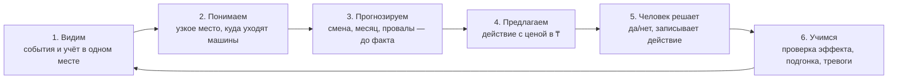

# Архитектура Allur Flow

ТЗ, «Ожидаемый результат»: «архитектура решения». Интерактивная версия этой схемы есть в самом сервисе, во вкладке **«Архитектура»**. Там три вида: 3D-слои, поток данных и цикл решения. По клику на блок видно, что он делает, на чём сделан и где лежит в коде.

Статус блоков: **работает** — сделано и проверено тестами; **на эмуляторе** — работает на эмуляторе линии или в «Испытаниях»; **следующий этап** — описано, но запускается только на заводе.

## 1. Слои: от завода до экрана

| Слой | Что делает | На чём | Где в коде |
|---|---|---|---|
| Завод | Откуда берутся данные: оборудование, учёт, люди | PLC, MES-выгрузки, телефон | `docs/INTEGRATION.md` |
| Приём данных | Приводит данные к одному виду, у каждого числа ставит метку источника, отсеивает мусор | FastAPI, Pydantic | `backend/app/ingest.py`, `live.py`, `data_quality.py` |
| Хранение | Журнал смен (день записывается один раз), прогнозы «до факта», уроки обучения, разборы брака | SQLite (дальше TimescaleDB) | `backend/app/db.py`, `journal.py`, `capa.py` |
| Ядро | Двойник линии, подгонка по журналам, прогноз и тревоги, качество | SimPy, NumPy/SciPy, LightGBM, River | `backend/app/sim/`, `learn/`, `spc.py`, `twin_calib.py` |
| Сервисы | Один сервер для экранов и данных; ИИ-помощник берёт числа только из функций двойника | FastAPI, OpenRouter | `backend/app/main.py`, `copilot/` |
| Экраны | Брифинг, двойник 3D/2D, обучение, испытания, архитектура | React 19, three.js / R3F, React Flow, ECharts | `frontend/src/` |

## 2. Цикл решения: ради чего всё устроено

## 3. Правила, которые держит архитектура

1. **У каждого числа есть метка источника**: факт / расчёт / допущение / симуляция / прогноз / ответ человека.
2. **Прогноз записывается до факта** и потом сверяется с фактом. Самопроверку двойника по своим же расчётам мы честно отделяем от сверки с данными завода.
3. **ИИ-помощник не придумывает числа.** Он вызывает функции двойника, и каждое число в ответе сверяется с результатом расчёта.
4. **Линия описана файлом** (`data/line.json`): новую линию можно подключить без программиста.
5. **Новая модель становится основной**, только если она точнее текущей на 3% на днях, которых не видела. Все версии хранятся в реестре, а ввод брака человеком можно откатить.

## 4. Как запускается

| | Сейчас (прототип) | На заводе (следующий этап) |
|---|---|---|
| Сервер | Один ПК: Python-сервер отдаёт и расчёты, и сайт | Docker Compose + Caddy (HTTPS): файлы готовы, на этом ПК не запускались |
| База | SQLite, один файл | TimescaleDB для длинной истории событий |
| Данные с линии | Эмулятор PLC через тот же вход `/api/live/events` | Шлюз OPC UA / MQTT (Node-RED или Kepware, брокер EMQX) |
| Учёт | Тестовые таблицы ТЗ; загрузка своих Excel/Word/CSV | Выгрузка из MES раз в сутки: двойник сам подгоняет надёжность участков |
| Телефон | PWA: устанавливается как приложение, без сети работает на записанных прогонах | То же, плюс QR-коды у станков |

Подробно о подключении к заводу: `docs/INTEGRATION.md`. Формат данных для IT-службы Allur: `DATA_FORMAT.md`.
