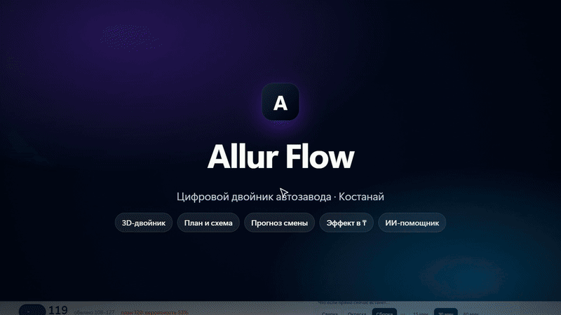

# Allur Flow — цифровой двойник автозавода Allur

Прототип для кейса №2 Qostanai Industry Hackathon. Правила и стек — `AGENTS.md`, план — `PLAN.md`, журнал — `PROGRESS.md`.



Ролик 24 с со звуком: [`media/allur-flow-promo.mp4`](media/allur-flow-promo.mp4). Архитектура — `ARCHITECTURE.md`, сценарий демо — `DEMO.md`.
Для эксперта: [`REVIEW.md`](REVIEW.md) — карта по критериям, результаты JSON/CSV в [`results/`](results/).
Ролик пересобирается из живого интерфейса: `node promo/record.cjs` (запись) → `python promo/build.py <запись> <результат>` (монтаж и звук).

## Задача и решение
**Кейс (АО «Группа компаний АЛЛЮР»):** цифровой двойник автозавода — визуализация участков и оборудования, мониторинг производительности, загрузки, простоев и качества, инциденты, панель руководителя, прогноз простоев и узких мест с ИИ.

**Allur Flow — помощник начальника смены:** видит проблему на линии → показывает, как она пойдёт по цепочке «сварка → окраска → сборка → ОТК» → предлагает действие с ценой в тенге → человек подтверждает «да / нет» → двойник проверяет эффект и учится. Каждое число помечено источником: факт заказчика, расчёт, симуляция, прогноз или допущение.

## Быстрый старт (Windows, один клик)
| Файл | Что делает |
|---|---|
| `start.bat` | Ставит всё нужное (Python 3.12, Node 20+ должны быть установлены), спрашивает ключ ИИ (можно пропустить), собирает сайт и открывает http://localhost:8000 |
| `verify.bat` | Одна команда проверки: 76 тестов → метрики против базовых подходов → `results/RESULTS.md` и результаты JSON/CSV |

```bash
start.bat            # установка и запуск: http://localhost:8000
python verify.py     # тесты (pytest) + метрики против базовых подходов -> results/RESULTS.md
```

Без ключа OpenRouter работает всё, кроме свободных ответов ИИ-помощника: он переходит на быстрые ответы по тем же расчётам двойника. Прогнозы (LightGBM), тревоги, симуляция и все экраны ключа не требуют.

## Что умеет (по требованиям ТЗ)
| Требование ТЗ | Где |
|---|---|
| Визуализация участков и оборудования | «Двойник»: 3D, План, Схема — склад → сварка (ABB-01/04) → окраска (Камера-02) → сборка (Конвейер-03) → ОТК → склад |
| Производительность, загрузка, простои, качество | Блок «Показатели ТЗ» на «Фактах» (данные Allur) и на «Двойнике» (симуляция дня) |
| Инциденты и отклонения | «Главные проблемы», журнал событий, нормы по дням, контрольная карта брака (Шухарт), разбор 8D |
| Панель руководителя | «Брифинг» в 08:00, журнал и прогноз месяца, «Эффект для завода» |
| Прогноз простоев и узких мест (ИИ) | Узкое место дня и шанс простоя > 60 мин; прогноз выпуска на 2 ч (LightGBM) и риск провала; «что если встанет участок» |
| Архитектура | Вкладка «Архитектура» (3D-слои, поток данных, цикл решения), [`ARCHITECTURE.md`](ARCHITECTURE.md) |
| Демонстрация сценариев | [`DEMO.md`](DEMO.md) — 3 минуты, ролик в `media/` |
| Эффект для бизнеса | «Эффект для завода»: машины за смену, минуты простоя, OEE, ₸ в год, окупаемость |

## Результаты (пересобираются `verify.bat`)
Полная таблица — [`results/RESULTS.md`](results/RESULTS.md); данные — [`results/`](results/) (JSON и CSV).

| Метрика | Allur Flow | База | На чём проверено |
|---|---|---|---|
| Ошибка прогноза выпуска на 2 ч, машин (MAE) | **2,66** | 4,03 (как за прошлые 2 ч) | 10 отложенных потоков, не в обучении |
| Покрытие коридора 90% | **88%** | цель 90% | прогноз до факта |
| Риск провала выпуска: поймано провалов | **49%** | 15% (случайная тревога) | порог выбран по цене ошибок на отдельных днях |
| Точность прогноза смены на реальной фабрике | **85,8%** | 84,8% (план) | открытый набор UCI 597, 24 дня |
| Сбои данных пойманы / ложные тревоги | **6 из 6 / 0** | — | 6 типов искажений потока |
| Прогноз смены против данных Allur | **2 из 2** в коридоре | — | 01–02.10 из ТЗ (данных мало — вывод предварительный) |

## Архитектура (кратко)
```
Завод (PLC, учёт MES, люди) → Приём данных (файлы, события, ответы) → Хранение (SQLite: журнал смен, обучение, 8D)
  → Ядро (двойник SimPy, прогноз LightGBM/River, качество SPC/8D, испытания) → Сервер FastAPI + ИИ-помощник → Экраны React/three.js
```
Подробно — [`ARCHITECTURE.md`](ARCHITECTURE.md) и вкладка «Архитектура».

## Ограничения (честно)
- Данных заказчика — 2 дня (DOCX из ТЗ). Остальная история и обучение моделей — на эмуляторе завода, это подписано «симуляция».
- Живые события с линии принимаются и показываются, но в расчёты двойника пока не идут — первый шаг пилота.
- Запросы на изменение (POST) не закрыты паролем; перед публичным размещением нужен PIN администратора.
- Docker Compose и проверка на GitHub (CI) подготовлены, но не запускались на машине разработчиков.
- Сверка с ТЗ: [`spec-compliance/`](spec-compliance/).

Лицензии используемых библиотек и данных — [`THIRD_PARTY_NOTICES.md`](THIRD_PARTY_NOTICES.md).

## Запуск вручную (Windows)
1. Сервер:
   ```
   cd backend
   .venv\Scripts\python -m uvicorn app.main:app --port 8000
   ```
2. Интерфейс (в другом окне):
   ```
   cd frontend
   npm run dev
   ```
3. Открыть http://localhost:5173

Первая установка: `py -3.12 -m venv backend\.venv`, `backend\.venv\Scripts\pip install -r backend\requirements.txt`, `cd frontend && npm ci`.
Ключ OpenRouter — в файле `.env` (не коммитится): скопируйте `.env.example` в `.env` и впишите свой ключ. Без ключа копилот работает офлайн.

## Приложение на телефоне и ПК (PWA)
Allur Flow устанавливается как приложение и открывается без интернета (Двойник и Испытания — на записанных прогонах).

1. Собрать интерфейс и запустить сервер — он отдаёт и API, и интерфейс с одного адреса:
   ```
   cd frontend && npm run build
   cd ..\backend
   .venv\Scripts\python -m uvicorn app.main:app --port 8000
   ```
2. Открыть http://localhost:8000 в Chrome/Edge → значок «Установить приложение» в адресной строке (на телефоне: меню ⋮ → «Добавить на главный экран»; iPhone/Safari: «Поделиться» → «На экран „Домой“»).
3. Без сервера приложение откроется из кеша и покажет плашку «Офлайн-режим». Копилоту, загрузке данных, дообучению и голосованию нужен сервер — там будет «Нужно подключение к серверу».
4. Новая версия не перезагружает страницу сама: появится плашка «Доступна новая версия — Обновить».

Важно: service worker работает только по **HTTPS** или на `localhost`. С телефона по адресу `http://192.168.x.x:8000` приложение откроется, но не установится и не будет работать офлайн — нужен HTTPS (см. Docker ниже).

`npm run dev` (порт 5173) — для разработки, там service worker выключен.

Записанные прогоны (replay) лежат в `frontend/public/bundles/`. После изменения модели их нужно перевыгрузить: `backend\.venv\Scripts\python backend\scripts\export_bundles.py` (только «Испытания»: `--only-stress`).

## Docker (одной командой, с HTTPS)
Нужен Docker Desktop (Compose 2.24+).
```
copy .env.example .env      # вписать ключ OpenRouter (необязательно) и при желании ALLUR_DOMAIN
docker compose up -d --build
```
- Откроется https://localhost (сертификат локальный — браузер попросит подтвердить один раз).
- `app` — Python 3.12 + собранный интерфейс; тяжёлый `requirements-ai.txt` (PyTorch) не ставится: результаты TimesFM уже в `data/tsfm_results.json`.
- `caddy` — HTTPS и сжатие перед `app`.
- Голоса, калибровка, новые версии моделей и загруженные данные хранятся в томе `allur-data` и переживают перезапуск. Секреты — только в `.env`, в образ он не попадает (`.dockerignore`).
- Остановить: `docker compose down` (данные останутся; `down -v` — удалит и их).

## Деплой на сайт (только после согласования с владельцем проекта)
1. Сервер Linux с Docker, открыты порты 80 и 443.
2. DNS: A-запись домена (например, `allur.example.kz`) → IP сервера.
3. На сервере: скопировать проект, создать `.env`, вписать `ALLUR_DOMAIN=allur.example.kz` (и ключ OpenRouter, если нужен).
4. `docker compose up -d --build` — Caddy сам получит сертификат Let's Encrypt.
5. Проверить: `https://<домен>/api/health` → `{"status":"ok"}`, затем установка приложения и QR на `/vote` (он берёт адрес сайта сам).
6. Реальные данные завода на публичный сервер не загружать без решения владельца.
