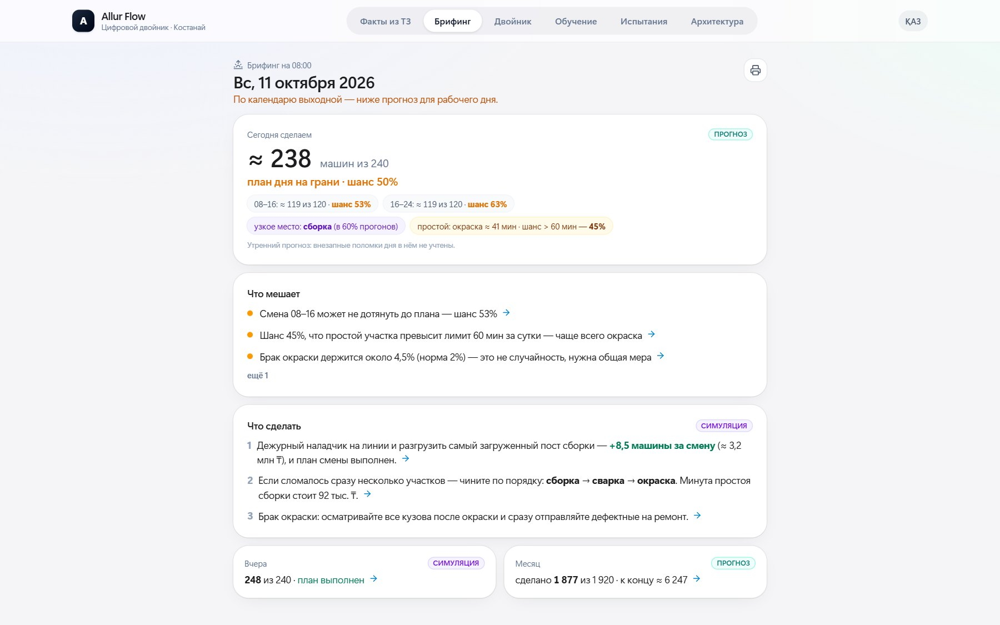
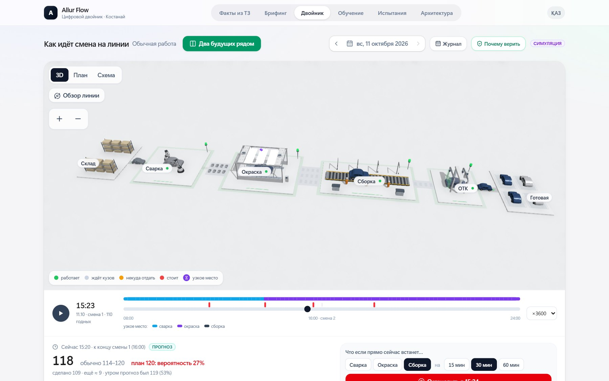
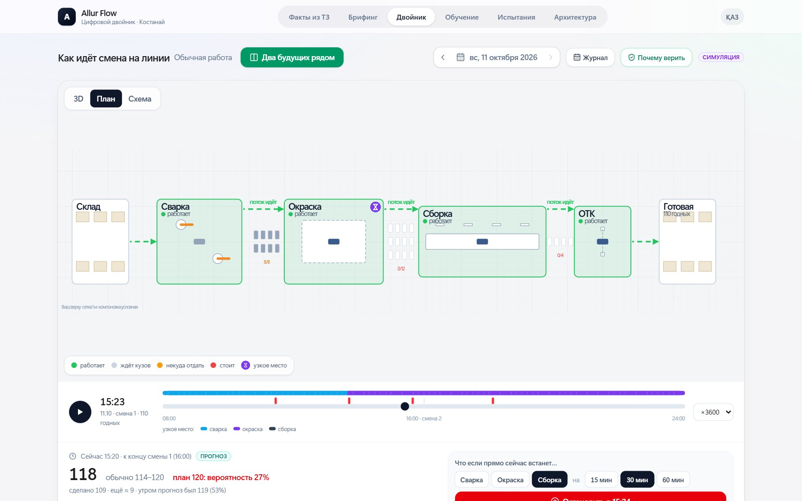
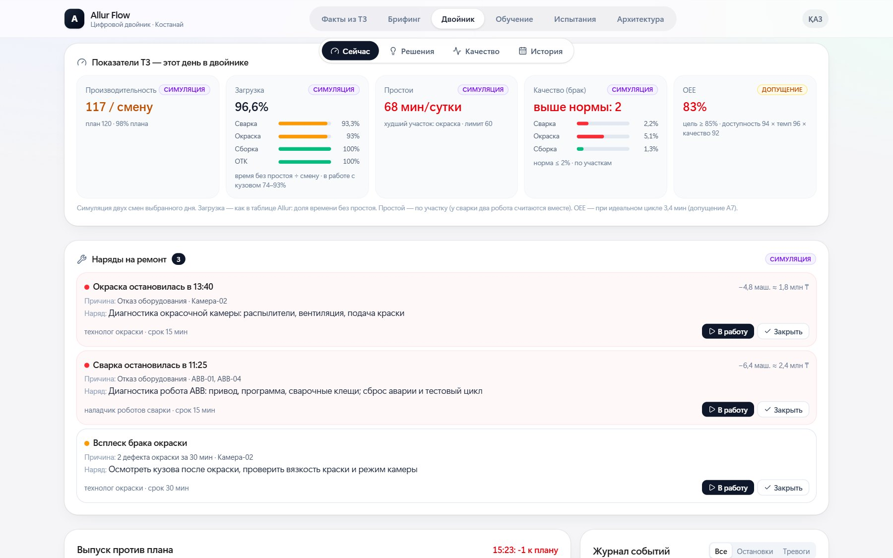
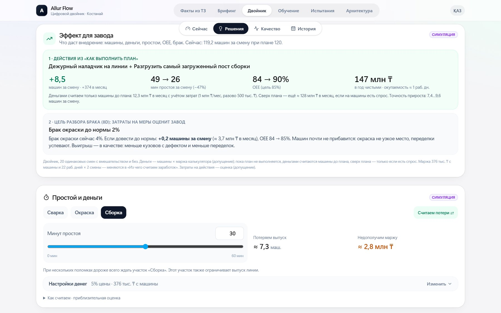
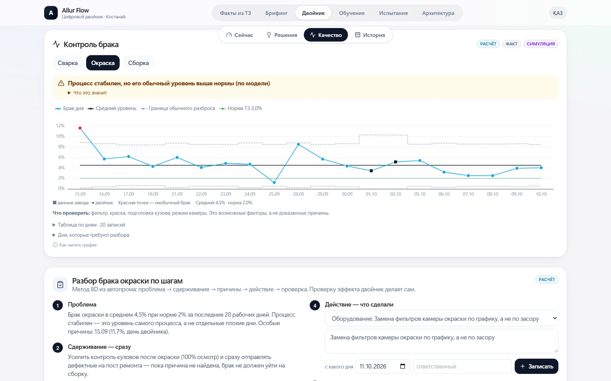
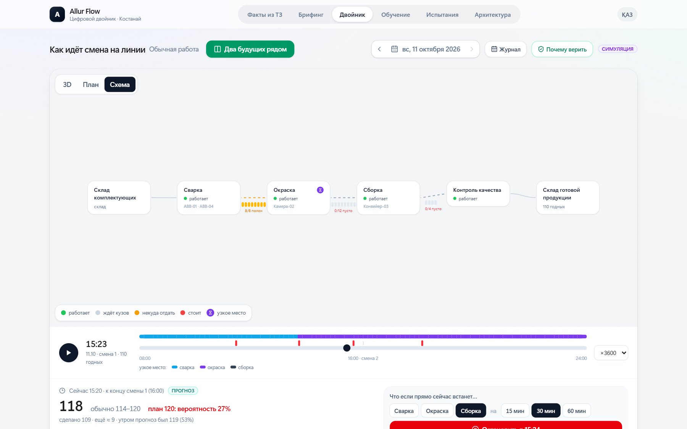
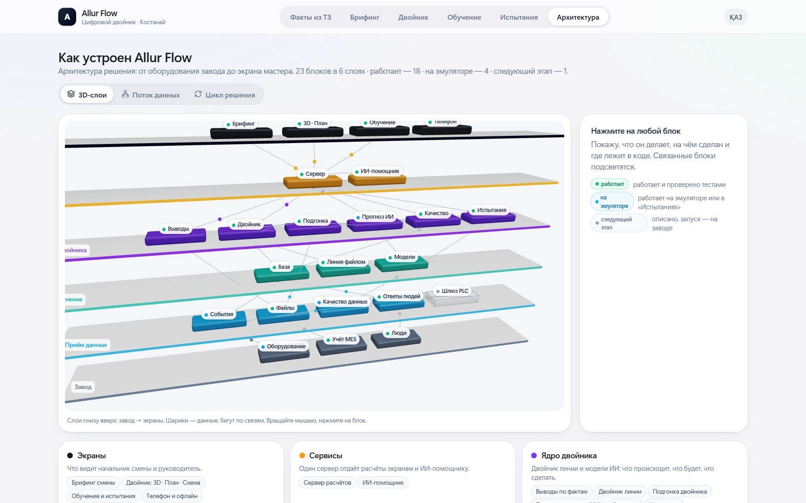
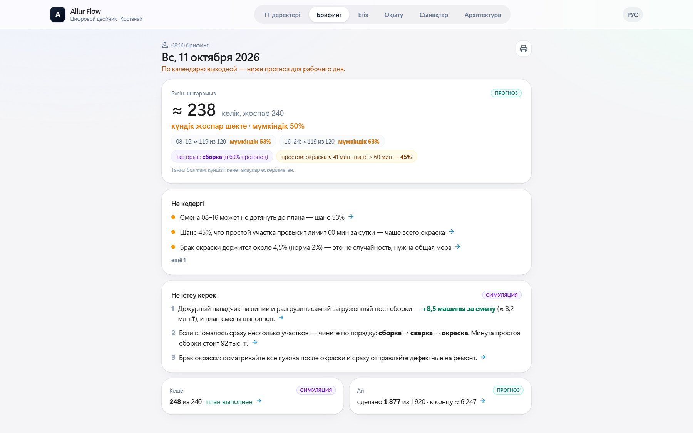

# Allur Flow — цифровой двойник автозавода Allur

[](https://github.com/amir2008bai/allur-flow/actions/workflows/ci.yml) · лицензия MIT · кейс №2 Qostanai Industry Hackathon (АО «Группа компаний АЛЛЮР»)

**Помощник начальника смены:** видит проблему на линии «сварка → окраска → сборка → ОТК», считает, сколько машин она съест, предлагает действие с ценой в тенге и проверяет эффект. Каждое число помечено источником: факт заказчика, расчёт, симуляция, прогноз или допущение.

| Главное | Число | Откуда |
|---|---|---|
| Проверено на **реальной фабрике** (UCI 597, 486 прогнозов) | ошибка **9,98 п.п.** против 10,64 у плана и 11,84 у «как вчера»; разница значима (95% ДИ) | факт, [`validation/real-factory/`](validation/real-factory/) |
| Коридор прогноза «90%» | **91%** на реальной фабрике, **90%** на эмуляторе | прогноз до факта |
| Лучшее действие на смену | **+8,5 машины** (95% ДИ 7,4…9,6), простой 49 → 26 мин, OEE 84 → 90% | симуляция, 20 парных смен |

```bash
python verify.py     # 80 тестов + все метрики против базовых подходов -> results/RESULTS.md, README
```
Запуск: `start.bat` (Windows) или `./start.sh` (Linux/macOS) → http://localhost:8000. API с описанием: http://localhost:8000/docs.
Короткие команды: `make run`, `make verify`, `make real`, `make docker`. Для эксперта: [`REVIEW.md`](REVIEW.md) — карта по критериям; результаты JSON/CSV — [`results/`](results/); ролик 24 с — [`media/allur-flow-promo.mp4`](media/allur-flow-promo.mp4).


## Скриншоты
| Брифинг смены | 3D-двойник | План цеха |
|---|---|---|
|  |  |  |
| **Сейчас: показатели ТЗ и наряды** | **Эффект для завода** | **Контроль брака** |
|  |  |  |
| **Схема потока** | **Архитектура (3D)** | **Қазақша** |
|  |  |  |

## Быстрый старт
| Система | Команда | Что делает |
|---|---|---|
| Windows | `start.bat` | Ставит зависимости (нужны Python 3.12 и Node 20+), спрашивает ключ ИИ (можно пропустить), собирает сайт, открывает http://localhost:8000 |
| Linux / macOS | `./start.sh` | То же самое |
| Docker | `docker compose up -d --build` | API + сайт + HTTPS (Caddy) на https://localhost |
| Проверка | `python verify.py` (или `verify.bat`) | Тесты → метрики против базовых подходов → `results/RESULTS.md`, таблица ниже, JSON/CSV |

Без ключа OpenRouter работает всё, кроме свободных ответов ИИ-помощника: он переходит на быстрые ответы по тем же расчётам двойника. Прогнозы (LightGBM), тревоги, симуляция и все экраны ключа не требуют.

## Что умеет (по требованиям ТЗ)
| Требование ТЗ | Где |
|---|---|
| Визуализация участков и оборудования | «Двойник»: 3D, План, Схема — склад → сварка (ABB-01/04) → окраска (Камера-02) → сборка (Конвейер-03) → ОТК → склад |
| Производительность, загрузка, простои, качество | Блок «Показатели ТЗ» на «Фактах» (данные Allur) и на «Двойнике» (симуляция дня) |
| Инциденты и отклонения | «Главные проблемы», журнал событий, нормы по дням, контрольная карта брака (Шухарт), разбор 8D |
| Панель руководителя | «Брифинг» в 08:00, журнал и прогноз месяца, «Эффект для завода» |
| Прогноз простоев и узких мест (ИИ) | Узкое место дня и шанс простоя > 60 мин; прогноз выпуска на 2 ч (LightGBM) и риск провала; «что если встанет участок» |
| Архитектура | Вкладка «Архитектура» (3D-слои, поток данных, цикл решения), [`ARCHITECTURE.md`](ARCHITECTURE.md) |
| Демонстрация сценариев | [`DEMO.md`](DEMO.md) — 3 минуты, ролик в `media/` |
| Эффект для бизнеса | «Эффект для завода»: машины за смену, минуты простоя, OEE, ₸ в год, окупаемость |
| Действия по инцидентам | Наряды на ремонт: тревога → причина → наряд (кому, что, срок, цена простоя), статус в базе |
| Языки | Русский; қазақша — вкладки, брифинг, показатели и разделы (тексты выводов от сервера пока на русском) |

## Результаты (таблицу пишет `python verify.py`)
Полная таблица — [`results/RESULTS.md`](results/RESULTS.md), данные — [`results/`](results/) (JSON и CSV). Источник: fact — реальные данные, forecast — прогноз до факта на отложенных данных, sim — симуляция.

<!-- RESULTS:BEGIN -->
| Метрика | Allur Flow | База | На чём проверено |
|---|---|---|---|
| Ошибка прогноза выпуска на 2 ч, машин (MAE) | **2.66** | 4.03 (как за прошлые 2 ч) | 10 отложенных потоков эмулятора (не в обучении) |
| Покрытие коридора 90% (доля фактов внутри) | **0.899** | 0.9 (обещанное покрытие) | 10 потоков, прогноз до факта |
| Риск провала выпуска: AUC | **0.661** | 0.5 (угадывание) | 10 потоков; порог по цене ошибок |
| Риск провала: поймано провалов (recall) | **0.494** | 0.328 (случайная тревога с той же частотой) | порог 0.22; тревог 33% окон |
| Риск провала: тревога верна (precision) | **0.244** | 0.155 (случайная тревога (= доля провалов)) | 10 потоков эмулятора |
| РЕАЛЬНАЯ фабрика: ошибка прогноза выработки, п.п. (MAE) | **9.98** | 10.64 (план бригады) | UCI 597, 486 прогнозов за 24 дн. проверки; 95% ДИ разницы -1.25…-0.11 п.п. |
| РЕАЛЬНАЯ фабрика: ошибка против «как вчера», п.п. | **9.98** | 11.84 (как вчера) | 95% ДИ разницы -2.72…-0.93 п.п. |
| РЕАЛЬНАЯ фабрика: покрытие коридора 90% | **0.911** | 0.9 (обещанное покрытие) | 448 проверок |
| РЕАЛЬНАЯ фабрика: провалы выработки (AUC) | **0.712** | 0.34 («вчера был провал») | доля провалов 18% |
| Сбои данных пойманы | **6** | 6 (всего сбоев) | 6 типов искажений потока |
| Ложные тревоги проверки данных на чистом потоке | **0** | 0 (ноль) | чистый поток эмулятора |
| Прогноз смены против данных Allur: в коридоре | **2 из 2** | — (данных мало — вывод предварительный) | факты заказчика из ТЗ, 2 дн. |
| Подгонка двойника: восстановленное время ремонта, мин | **54.5** | 55 (скрытое истинное значение) | синтетический «завод» со скрытыми параметрами |

Тесты: **80 passed, 3 warnings in 86.83s (0:01:26)**. Пересобрано командой `python verify.py`.
<!-- RESULTS:END -->

Что важно знать о цифрах:
- Модели прогноза на 2 ч учатся и проверяются на **эмуляторе** завода (отложенные потоки, которых не было в обучении): данных Allur всего 2 дня. Поэтому тот же метод проверен на **реальной фабрике** — это главное доказательство.
- «Случайная тревога» сравнивается честно: с той же частотой тревог (recall) и с долей провалов (precision).

## Проверка на реальной фабрике (UCI 597)
Данных автозавода мало, поэтому метод Allur Flow проверен на открытых данных настоящего производства: [UCI 597 «Productivity Prediction of Garment Employees»](https://archive.ics.uci.edu/dataset/597/productivity+prediction+of+garment+employees) (CC BY 4.0) — 59 рабочих дней, 12 бригад, план и факт каждой смены. Задача та же, что у Allur: прогноз выработки к плану до начала смены и предупреждение о провале (< 80% плана).

| Модель | Ошибка, п.п. | Против плана | Против «как вчера» |
|---|---|---|---|
| **LightGBM на истории (как в Allur Flow)** | **9,98** | **−6%, значимо** (95% ДИ −1,25…−0,11 п.п.) | **−16%, значимо** (95% ДИ −2,72…−0,93 п.п.) |
| План бригады | 10,64 | — | −10% |
| «Как вчера» | 11,84 | +11% хуже | — |

- **Коридор «90%»:** факт внутри в **91,1%** случаев (448 проверок).
- **Провалы:** AUC **0,71** против 0,34 у правила «вчера был провал»; тревога верна в 38% случаев при доле провалов 18% (в 2 раза чаще случайного).
- **Устойчивость:** граница обучения 50% / 60% / 70% → ошибка 9,72 / 9,98 / 9,26 против плана 10,64 / 10,64 / 9,79.
- **Честно:** прогноз только по тому, что известно до смены (без простоев и сверхурочных этой смены); учимся на прошлых днях, проверяем на будущих; выигрыш над планом небольшой (≈0,7 п.п.), но устойчивый. Это швейная фабрика, а не автосборка: проверяется метод, а не цифры Allur.
- Пересчёт из сырых данных: `cd validation/real-factory && python validate_garment.py` (запускается и внутри `verify.py`). Отчёт — [`validation/real-factory/REPORT.md`](validation/real-factory/REPORT.md).

## Эффект в деньгах: из чего складывается
Двойник: 20 одинаковых смен с действием и без (одни и те же случайные поломки). Лучшая пара действий даёт +8,5 машины за смену, но **деньгами считаются только машины до плана**: сейчас двойник делает 119,2 из 120, разрыв 0,8 машины.

| Шаг | Значение | Источник |
|---|---|---|
| Машин до плана за смену | 0,8 | симуляция |
| × смен в месяц | 22 дня × 2 смены = 44 | допущение A8 |
| × маржа с машины | 375 тыс. ₸ (5% цены модели) | **допущение A8**, меняется в калькуляторе |
| − затраты на действие | 1 млн ₸/мес + 0,5 млн ₸ разово | оценка |
| **Итого в год** | **≈ 146 млн ₸** | расчёт |

Чувствительность к марже: 3% → ≈ 82 млн ₸; 5% без НДС 16% (323 тыс. ₸) → ≈ 124 млн ₸; 8% → ≈ 241 млн ₸. Остальные +7,7 машины за смену сверх плана в деньги не включены: они нужны, только если на машины есть спрос.

## План пилота на заводе (8 недель)
| Недели | Что делаем | Данные Allur | Кто пользуется | Чем меряем успех |
|---|---|---|---|---|
| 1–2 | Выгрузка журнала смен за 3–6 месяцев, подгонка двойника по ней | план/факт смен, простои, брак (MES/Excel, как в ТЗ) | технолог | двойник попадает в факт прошлых смен (коридор 90%) |
| 3–4 | Утренний брифинг в 08:00 и наряды на ремонт на одной линии | ежедневная выгрузка смены | начальник смены, ремслужба | прогноз смены записан до её начала и сверен с фактом |
| 5–6 | События с линии в реальном времени (OPC UA/MQTT → `/api/live/events`) | теги PLC ABB-01/04, Камера-02, Конвейер-03 | диспетчер | простои видны ≤ 1 мин, наряд создан сразу |
| 7–8 | Сравнение «с подсказками / без» по сменам | тот же журнал | директор производства | минуты простоя и машины к плану против прошлых смен |

Нужно от завода: выгрузка журнала смен, доступ на чтение к тегам PLC, один ответственный технолог. Сервер — одна машина в сети завода (Docker), данные наружу не уходят. Подключение — [`docs/INTEGRATION.md`](docs/INTEGRATION.md).

## Архитектура (кратко)
```
Завод (PLC, учёт MES, люди) → Приём данных (файлы, события, ответы) → Хранение (SQLite: журнал смен, обучение, 8D)
  → Ядро (двойник SimPy, прогноз LightGBM/River, качество SPC/8D, испытания) → Сервер FastAPI + ИИ-помощник → Экраны React/three.js
```
Подробно — [`ARCHITECTURE.md`](ARCHITECTURE.md) и вкладка «Архитектура».

## Ограничения (честно)
- Данных заказчика — 2 дня (DOCX из ТЗ). Остальная история и обучение моделей — на эмуляторе завода, это подписано «симуляция». Метод отдельно проверен на реальной фабрике (выше).
- Живые события с линии принимаются и показываются, но в расчёты двойника пока не идут — первый шаг пилота.
- Безопасность: для публичного запуска (`ALLUR_DOMAIN` не localhost) сервер не стартует без `ALLUR_ADMIN_PIN`; с PIN все изменения требуют его, вопросы к ИИ ограничены по частоте (`ALLUR_COPILOT_LIMIT`), загрузки — до 20 МБ.
- Казахский: интерфейс главных экранов; тексты выводов и ответы ИИ пока на русском.
- Сверка с ТЗ: [`spec-compliance/`](spec-compliance/). Внутренние заметки разработки — [`docs/dev/`](docs/dev/).

Лицензия — MIT ([`LICENSE`](LICENSE)). Лицензии библиотек и данных — [`THIRD_PARTY_NOTICES.md`](THIRD_PARTY_NOTICES.md).

## Запуск вручную (режим разработки)
1. Сервер:
   ```
   cd backend
   .venv\Scripts\python -m uvicorn app.main:app --port 8000
   ```
2. Интерфейс (в другом окне):
   ```
   cd frontend
   npm run dev
   ```
3. Открыть http://localhost:5173

Первая установка: `py -3.12 -m venv backend\.venv`, `backend\.venv\Scripts\pip install -r backend\requirements.txt`, `cd frontend && npm ci`.
Ключ OpenRouter — в файле `.env` (не коммитится): скопируйте `.env.example` в `.env` и впишите свой ключ. Без ключа копилот работает офлайн.

## Приложение на телефоне и ПК (PWA)
Allur Flow устанавливается как приложение и открывается без интернета (Двойник и Испытания — на записанных прогонах).

1. Собрать интерфейс и запустить сервер — он отдаёт и API, и интерфейс с одного адреса:
   ```
   cd frontend && npm run build
   cd ..\backend
   .venv\Scripts\python -m uvicorn app.main:app --port 8000
   ```
2. Открыть http://localhost:8000 в Chrome/Edge → значок «Установить приложение» в адресной строке (на телефоне: меню ⋮ → «Добавить на главный экран»; iPhone/Safari: «Поделиться» → «На экран „Домой“»).
3. Без сервера приложение откроется из кеша и покажет плашку «Офлайн-режим». Копилоту, загрузке данных, дообучению и голосованию нужен сервер — там будет «Нужно подключение к серверу».
4. Новая версия не перезагружает страницу сама: появится плашка «Доступна новая версия — Обновить».

Важно: service worker работает только по **HTTPS** или на `localhost`. С телефона по адресу `http://192.168.x.x:8000` приложение откроется, но не установится и не будет работать офлайн — нужен HTTPS (см. Docker ниже).

`npm run dev` (порт 5173) — для разработки, там service worker выключен.

Записанные прогоны (replay) лежат в `frontend/public/bundles/`. После изменения модели их нужно перевыгрузить: `backend\.venv\Scripts\python backend\scripts\export_bundles.py` (только «Испытания»: `--only-stress`).

## Docker (одной командой, с HTTPS)
Нужен Docker (Compose 2.24+). Сборка образа проверяется в CI.
```
copy .env.example .env      # вписать ключ OpenRouter (необязательно) и при желании ALLUR_DOMAIN
docker compose up -d --build
```
- Откроется https://localhost (сертификат локальный — браузер попросит подтвердить один раз).
- `app` — Python 3.12 + собранный интерфейс; тяжёлый `requirements-ai.txt` (PyTorch) не ставится: результаты TimesFM уже в `data/tsfm_results.json`.
- `caddy` — HTTPS и сжатие перед `app`.
- Голоса, калибровка, новые версии моделей и загруженные данные хранятся в томе `allur-data` и переживают перезапуск. Секреты — только в `.env`, в образ он не попадает (`.dockerignore`).
- Остановить: `docker compose down` (данные останутся; `down -v` — удалит и их).

## Деплой на сайт (только после согласования с владельцем проекта)
1. Сервер Linux с Docker, открыты порты 80 и 443.
2. DNS: A-запись домена (например, `allur.example.kz`) → IP сервера.
3. На сервере: скопировать проект, создать `.env`, вписать `ALLUR_DOMAIN=allur.example.kz` (и ключ OpenRouter, если нужен).
4. `docker compose up -d --build` — Caddy сам получит сертификат Let's Encrypt.
5. Проверить: `https://<домен>/api/health` → `{"status":"ok"}`, затем установка приложения и QR на `/vote` (он берёт адрес сайта сам).
6. Реальные данные завода на публичный сервер не загружать без решения владельца.
