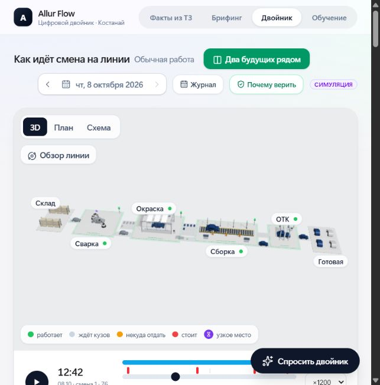

# Проверка обновлённых моделей 3D — 08.10.2026

Запрос: узнаваемые автомобили, более подробное оборудование и заметное движение автомобилей при сохранении существующей скорости и анимаций.

Изменения находятся в `frontend/src/twin/models.tsx`, `ModelDetails.tsx` и `Scene3D.tsx`. Геометрия процедурная; новые зависимости и внешние модели не добавлялись. Кузова на переходах иллюстрируют поток; это не отслеживание отдельных VIN. Четыре парковочных места условно показывают появление готового выпуска.

Проверено:
- TypeScript/Vite: `npm run build` завершился успешно. Размер Scene3D после gzip: 176,43 КБ (до: 174,62 КБ). Сохранилось предупреждение Vite о больших чанках.
- Сравнение с HEAD: все шесть прежних `useMotionFrame` в models.tsx совпадают; `SceneMotion.tsx`, `motion.ts`, `kinematics.ts` и `store.ts` не изменены. Коэффициент фазы переходов `dt * 0.16` сохранён.
- Локальный браузер: движение кузовов между участками, детали сборки/ОТК, готовые автомобили на стоянке; скорость ×1200.
- Пауза: два снимка области сцены совпали побайтно, размер каждого 35 022 байта. Таймлайн был остановлен на 11:04.
- В собранном приложении ошибок уровня error в журнале браузера не обнаружено.
- При 390×844 сцена отображается; на конце смены панель инцидента вызывает горизонтальное переполнение страницы. HTML/CSS интерфейса в этом изменении не затрагивались; полная мобильная адаптивность не заявляется. Временный размер браузера сброшен.

Backend повторно не проверялся: сервер и расчёты не изменялись. Новые 3D-модели не меняют точность прогнозов или производственные параметры.

Снимок обзора линии в обычном размере встроенного браузера:

