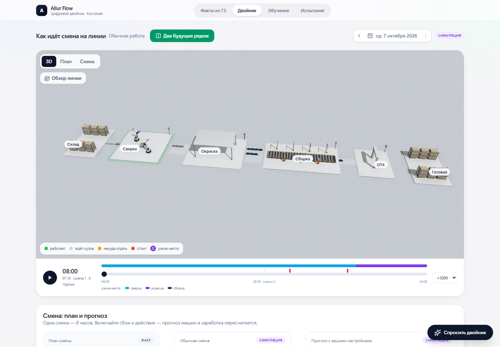
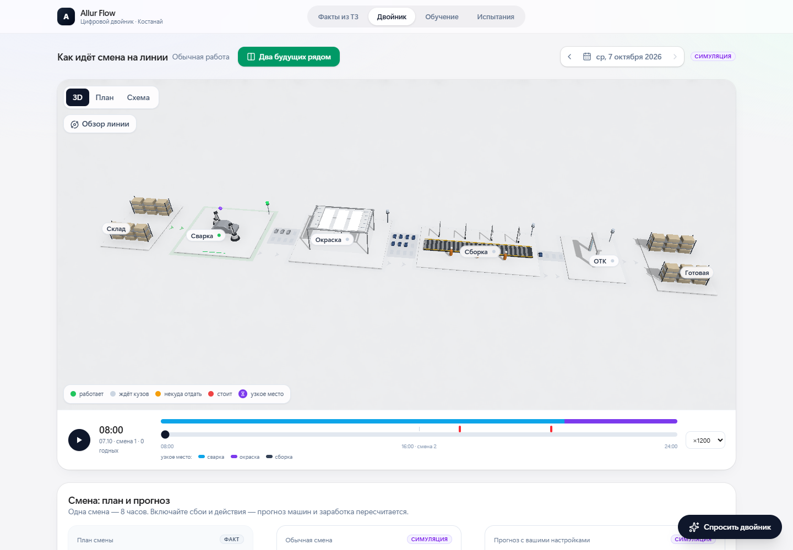
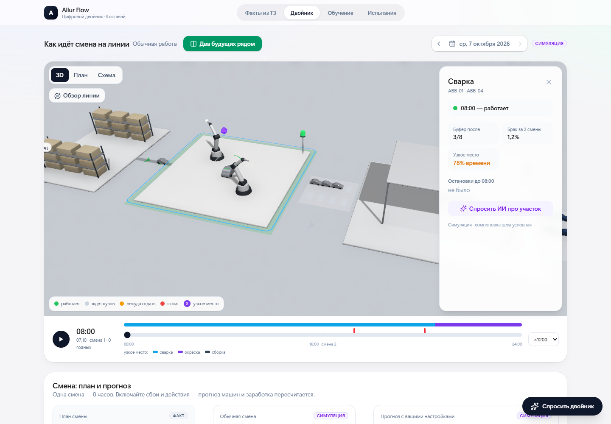
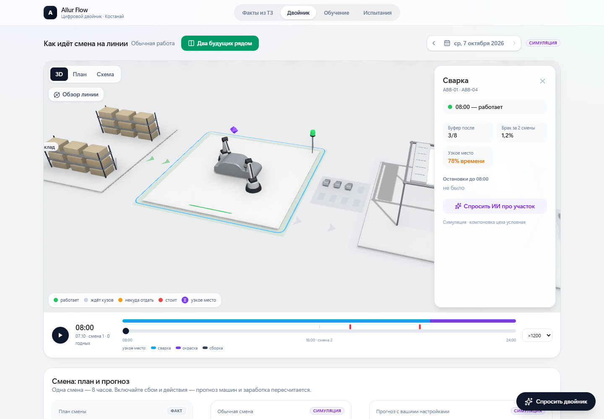

# Allur Flow · apple-3d · проверка 07.10.2026

Доработана 3D-сцена существующего Двойника. Данные, расчёты, API, версии библиотек и палитра статусов сохранены. Схема цеха и движения условные: это иллюстрация состояния симуляции, а не точные траектории реального завода.

Пауза немедленно сохраняет положения оборудования, частиц, материалы и текущий перелёт камеры. Визуальная скорость ограничена 0,65–1,35× при ускорении смены ×300–×7200. Кольцо с условным прогрессом заменено зелёным световым штрихом и точкой статуса. Сварочные инструменты касаются кузова; сборочный кузов движется вместе с лентой.

## Скриншоты

| Режим | До | После |
| --- | --- | --- |
| Вся линия, 1440×1000 |  |  |
| Выбрана сварка, 1440×1000 |  |  |

[Работа сварки](after-welding-active.png) · [Остановка](after-incident.png) · [Два будущих](after-futures.png) · [Телефон 390×844](after-phone.png)

## Проверки

- npm run build — успешно. Предупреждение о крупных чанках существовало ранее; зависимости не обновлялись.
- 3 теста визуальной скорости, полной паузы привода и геометрии контакта инструментов: Node 24, из frontend — node --test tests/twin-motion.test.mjs.
- 46 backend-тестов — успешно. Общий каталог Temp/pytest-of-Amir недоступен, поэтому --basetemp задан новым каталогом внутри рабочего ../tmp.
- Chrome/Playwright: пуск/пауза, точное равенство поз/частиц/материалов при мгновенной паузе, остановка перелёта, остановка обзора, старт обзора в конце смены, все четыре ускорения, динамическая настройка reduced motion, сбой, две 3D-сцены, мобильный План по умолчанию и отсутствие горизонтальной прокрутки. См. [checks.json](checks.json).
- Снимки на паузе совпадают с допуском Chrome backdrop-blur: не более 1/255 в отдельных краевых пикселях и средняя разница менее 0,001. Геометрия и материалы отдельно сравнивались без допуска.

## Производительность

Замер на Intel Iris Xe в локальном headless Chrome, 1440×1000, два повторения по 120 кадров requestAnimationFrame. База взята непосредственно из master (3d8cff3), сервер/API и параметры одинаковые; страницы измерялись последовательно.

| Показатель | До | После |
| --- | ---: | ---: |
| Средний FPS двух повторений | 28.5 | 38.0 |
| Изменение | — | +34% |

Мобильный размер 390×844, quality=low: 74.5 FPS. Это эмуляция размера/касания на ПК, а не замер физического телефона или заводского ПК. Подробности и p95 — в [performance.json](performance.json).

## Передача

apple-3d.bundle содержит только изменения master..apple-3d и требует исходную базу master (3d8cff3fc9fbfb11efcd632b96050a8bb007e9dc). В существующем репозитории его можно проверить командой git bundle verify <путь-к-файлу>, затем получить ветку git fetch <путь-к-файлу> apple-3d:apple-3d. Для проверки интерфейса: README проекта, затем Двойник → 3D → Пуск. PNG и результаты включены в ветку.
